> **Versão de 26/11/2026.** Os nomes de botões e telas foram copiados do aplicativo, e as imagens
> são telas reais do app. A mesma ajuda está on-line, com busca e filtro por perfil, na
> **Central de Ajuda**: <https://gestaofrota.runasp.net/ajuda.html> (menu > **Ajuda** no app, ou
> **Precisa de ajuda?** na tela de entrada).

# Para que serve o aplicativo

O **Gestão de Frota** organiza, no celular, o dinheiro da empresa e o uso dos caminhões:

- o que entrou e o que saiu do caixa, com foto do comprovante;
- os financiamentos e as parcelas que vão vencer;
- os veículos, as rotas e as viagens de cada motorista;
- relatórios que mostram quanto cada rota e cada caminhão dão de lucro.

# Antes de começar

- Um celular **Android 6.0 ou mais novo**, com o aplicativo instalado. Quem cuida do sistema na
  empresa envia o arquivo de instalação e explica como instalar.
- Uma **conta Google** (Gmail). Você entra com ela; o aplicativo não tem senha própria.
- **Internet** para quase tudo. A exceção é o motorista abrindo e encerrando viagens, que funciona
  sem sinal (veja [Sem internet](#sem-internet)).

# Entrar e sair

1. Abra o aplicativo **Gestão de Frota**.
2. Toque em **Entrar com Google** e escolha a sua conta.
3. Pronto. Nas próximas vezes o aplicativo já abre com você conectado.

**Primeira vez?** Toda conta nova entra como **Motorista**. Se o seu trabalho é outro, peça ao
administrador para mudar o seu perfil (veja [Usuários](#usuários)).

**Para sair:** abra o menu (o ícone ☰ no canto de cima) e toque em **Sair**, no fim da lista.

**Precisa de ajuda?** No menu, toque em **Ajuda**: a Central de Ajuda abre no navegador, já
filtrada para o seu perfil. Na tela de entrada, antes de fazer login, use **Precisa de ajuda?**.

{width=32%}

# O que cada perfil vê

O menu lateral mostra só o que o seu perfil pode usar. O seu nome e o seu perfil aparecem no topo
do menu.

| Tela do menu | Administrador | Gestor de Frota | Financeiro | Motorista |
|---|:---:|:---:|:---:|:---:|
| Início | ✔ | ✔ | ✔ | ✔ |
| Viagens | ✔ | ✔ | — | ✔ (só as suas) |
| Frota | ✔ | ✔ | — | ✔ (só consulta) |
| Rotas | ✔ | ✔ | — | — |
| Movimentações | ✔ | ✔ (só consulta) | ✔ | — |
| Dívidas e Financiamentos | ✔ | ✔ (só consulta) | ✔ | — |
| Relatórios | ✔ | ✔ | ✔ | — |
| Categorias | ✔ | ✔ (só consulta) | ✔ | — |
| Formas de Pagamento | ✔ | ✔ (só consulta) | ✔ | — |
| Usuários | ✔ | — | — | — |

O **Motorista** abre o aplicativo direto na tela **Viagens**.

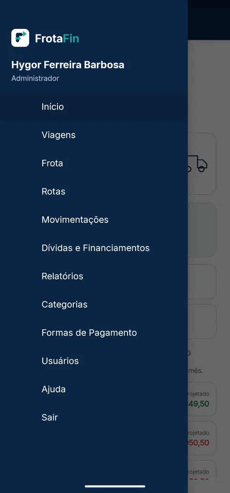{width=32%}
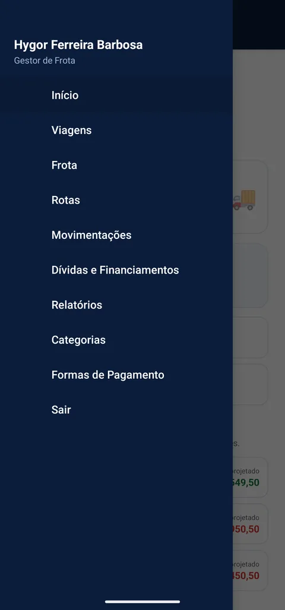{width=32%}

# Início

É o resumo do caixa:

- **Saldo atual (pago/recebido):** o dinheiro que de fato entrou menos o que de fato saiu. Contas
  ainda não pagas não entram aqui.
- **Entradas pagas, Saídas pagas, A receber e A pagar.**
- **Projeção de caixa por mês de vencimento:** quanto vai sobrar em cada mês se tudo o que está
  pendente for pago no vencimento.
- **Veículos em viagem:** quantos caminhões estão rodando agora.

Para atualizar qualquer lista do aplicativo, **puxe a tela para baixo**.

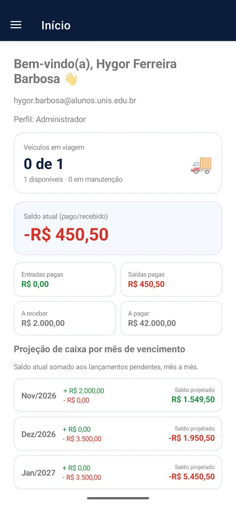{width=32%}

# Movimentações (entradas e saídas)

## Lançar uma entrada ou saída

1. Menu > **Movimentações** > **+ Nova movimentação**.
2. Escolha o **Tipo**: Receita (entrou dinheiro) ou Despesa (saiu dinheiro).
3. Preencha o **Valor (R$)**, a **Descrição** (ex.: "Abastecimento caminhão 01"), a
   **Categoria** e a **Forma de pagamento**.
4. Informe a **Data de vencimento**.
5. Se já foi pago ou recebido, informe também a **Data do pagamento/recebimento**.
6. Se for combustível, preencha **Litros abastecidos**.
7. Se o gasto ou a receita for de uma viagem, escolha em **Vincular à viagem**. É isso que permite
   calcular o custo por quilômetro de cada viagem.
8. Toque em **Salvar movimentação**.

O valor precisa ser maior que zero.

## Anexar o comprovante

Na mesma tela, em **Comprovante (opcional)**:

- **📷 Câmera** tira a foto na hora;
- **🖼 Galeria** escolhe uma foto que já está no celular.

A foto pode ter até 5 MB. Para ver depois, toque em **Comprovante** no lançamento, na lista.

Na primeira vez o celular pede permissão para a câmera. Se você negar, a **Galeria** continua
funcionando; se bloquear de vez, o aplicativo oferece **Abrir configurações** para liberar.

## Marcar como pago

Na lista de **Movimentações**, toque em **Marcar como pago** no lançamento pendente. A partir daí ele
entra no saldo.

## Estornar

**Estornar** cancela um lançamento feito por engano sem apagá-lo: ele continua no histórico, mas sai
do saldo, da projeção e dos relatórios.

Use os filtros **Tipo** e **Situação**, no alto da lista, para achar um lançamento.

Lançar, marcar como pago e estornar são do **Administrador** e do **Financeiro**. O Gestor de Frota
vê a lista só para consulta, sem esses botões.

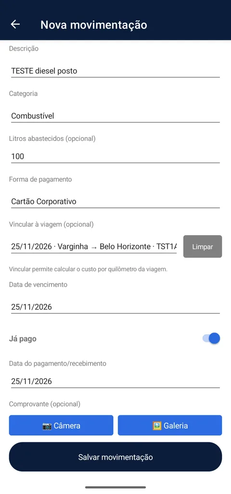{width=32%}
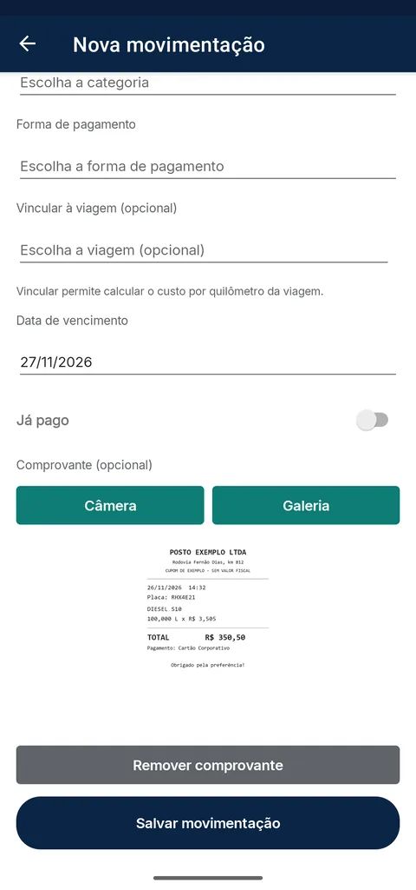{width=32%}
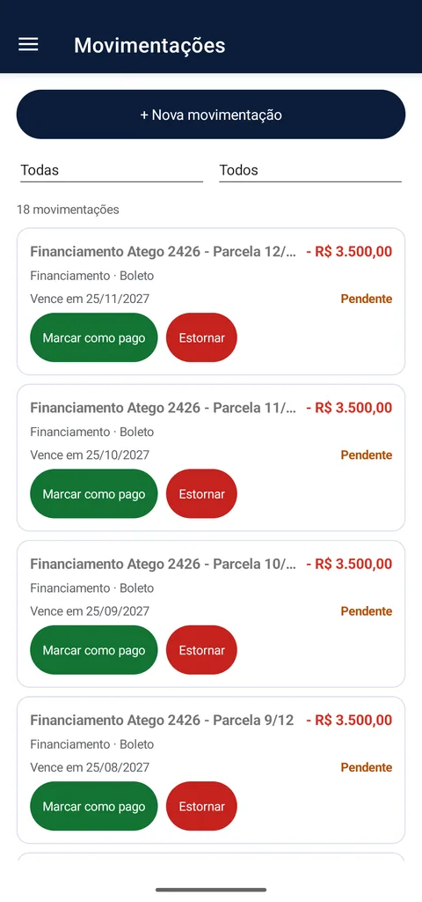{width=32%}

# Dívidas e Financiamentos

Use para financiamentos e compras parceladas: o aplicativo cria todas as parcelas de uma vez.

1. Menu > **Dívidas e Financiamentos** > **+ Novo financiamento**.
2. Preencha a **Descrição** (ex.: "Financiamento caminhão Volvo FH"), o **Valor da parcela (R$)**, a
   **Quantidade de parcelas** e o **Vencimento da 1ª parcela**.
3. Se o banco informou um valor para quitar tudo antes, preencha **Valor para quitação antecipada**.
   Ele fica registrado para consulta.
4. Escolha a **Categoria das parcelas** e a **Forma de pagamento**.
5. Toque em **Salvar e gerar parcelas**.

O aplicativo cria uma parcela pendente por mês. Elas aparecem em **Movimentações** e na projeção do
Início. Para pagar uma parcela, abra a dívida e toque em **Marcar parcela como paga**.

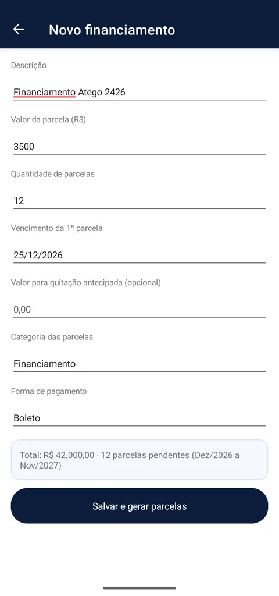{width=32%}
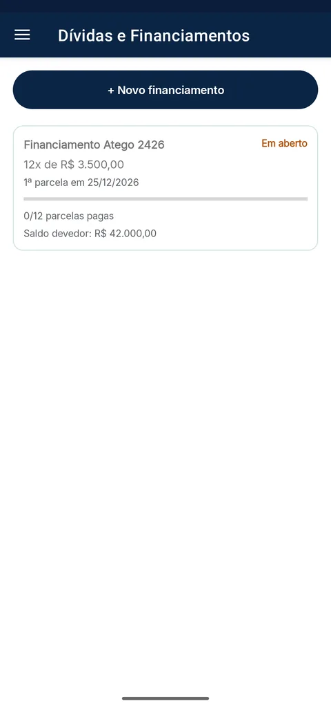{width=32%}

# Categorias e Formas de Pagamento

O aplicativo já vem com as categorias Frete, Combustível, Pedágio, Manutenção, Salários e
Financiamento, e com as formas Pix, Boleto, Transferência TED e Cartão Corporativo.

- **Nova categoria:** digite o **Nome da categoria**, escolha o **Tipo** e toque em
  **Adicionar categoria**. Para mudar o nome, toque em **Editar**.
- **Desativar** (só o Administrador) tira a categoria das opções novas sem apagar os lançamentos
  antigos que a usam.
- **Nova forma de pagamento:** digite o nome e toque em **Adicionar forma de pagamento**.

# Frota

## Cadastrar um veículo

1. Menu > **Frota** > **+ Novo veículo**.
2. Preencha a **Placa**, no formato antigo (ABC-1234) ou Mercosul (ABC1D23). O aplicativo não aceita
   duas vezes a mesma placa.
3. Preencha **Marca**, **Modelo**, **Ano de fabricação**, **Capacidade de carga (t)** e
   **Hodômetro atual (km)**.
4. Toque em **Salvar veículo**.

Cada veículo mostra a situação: **Disponível**, **Em viagem** ou **Em manutenção**.

## Registrar uma manutenção

1. Em **Frota**, toque em **Registrar manutenção** no veículo.
2. Preencha a **Data da manutenção**, a **Descrição do serviço**, o **Valor total (R$)** e a
   **Forma de pagamento da despesa**.
3. Se já foi pago, marque **Já pago** e informe a **Data do pagamento**.
4. Toque em **Salvar manutenção**.

O aplicativo faz duas coisas sozinho: lança a despesa no caixa, na categoria Manutenção, e coloca o
veículo como **Em manutenção**, para ele não ser escolhido numa viagem. Quando o serviço terminar,
toque em **Concluir manutenção** e o veículo volta a ficar **Disponível**.

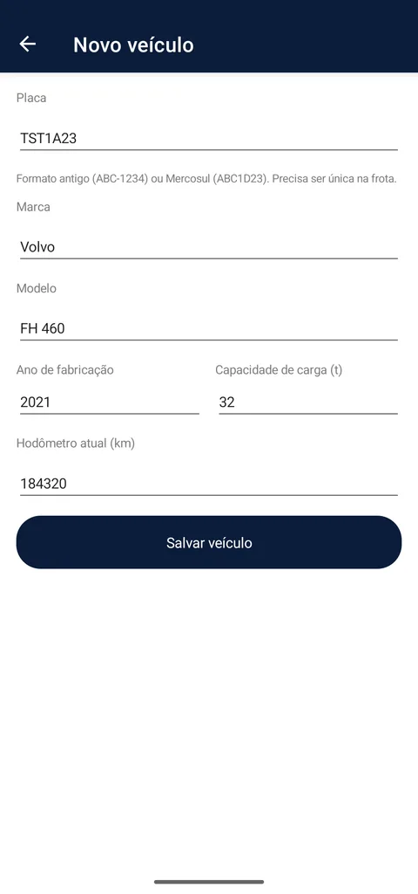{width=32%}
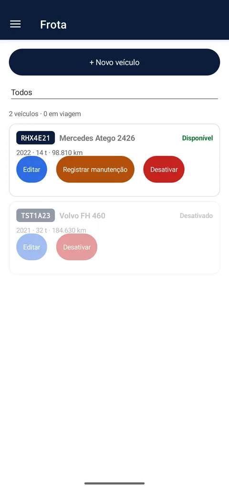{width=32%}

# Rotas

Menu > **Rotas**: preencha o **Nome da rota** (ex.: "SP → Curitiba"), a **Origem**, o **Destino** e a
**Distância estimada (km)**, e toque em **Adicionar rota**. Use **Editar** para corrigir e
**Desativar** (só o Administrador) para tirar uma rota que não é mais usada.

# Viagens

## Abrir uma viagem

1. Menu > **Viagens** > **+ Abrir viagem**.
2. Escolha o **Veículo** (só aparecem os disponíveis), a **Rota** e o **Motorista**. Quem está logado
   como Motorista só abre viagem para si mesmo.
3. Confira o **Hodômetro inicial (km)**: ele já vem com o último registrado do veículo.
4. Toque em **Abrir viagem**.

O veículo passa a **Em viagem**.

## Encerrar a viagem

1. Em **Viagens**, toque em **Encerrar viagem**.
2. Informe o **Hodômetro final (km)**. Ele precisa ser maior que o inicial.
3. Toque em **Confirmar encerramento**.

O aplicativo calcula a quilometragem rodada sozinho, e o veículo volta a ficar disponível.

## Cancelar

O Administrador e o Gestor podem **Cancelar** uma viagem aberta por engano. O veículo volta a ficar
disponível e a quilometragem não é contada.

## Sem internet

Abrir e encerrar viagens **funciona sem sinal**:

- aparece o aviso "Sem conexão…", e a viagem fica guardada no celular;
- na lista, ela aparece como **Aberta · aguardando envio** ou **Encerrada · aguardando envio**;
- quando o sinal voltar, abra **Viagens** e **puxe a tela para baixo**. O aplicativo envia o que
  ficou guardado.

Mesmo que o envio caia no meio, nada é registrado em dobro. As outras telas (lançamentos, dívidas,
cadastros) precisam de internet. Sem sinal, o aplicativo avisa em vez de fingir que salvou.

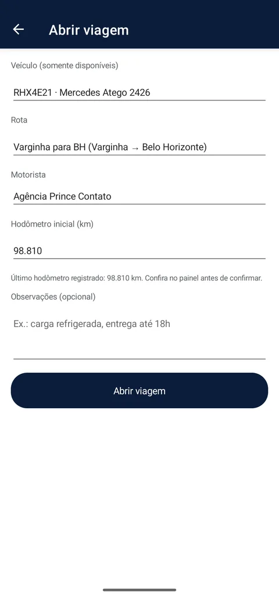{width=32%}
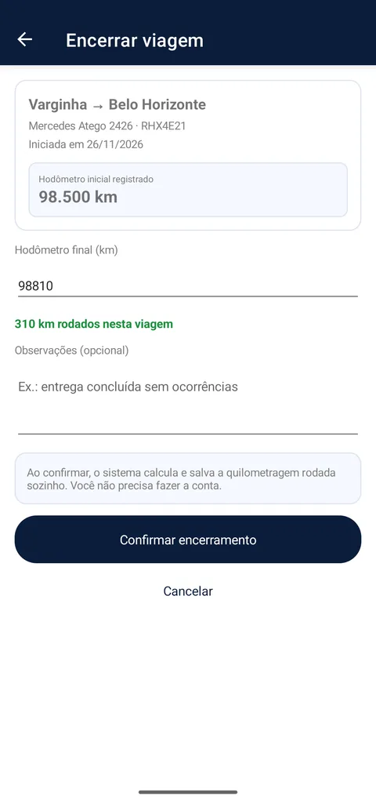{width=32%}
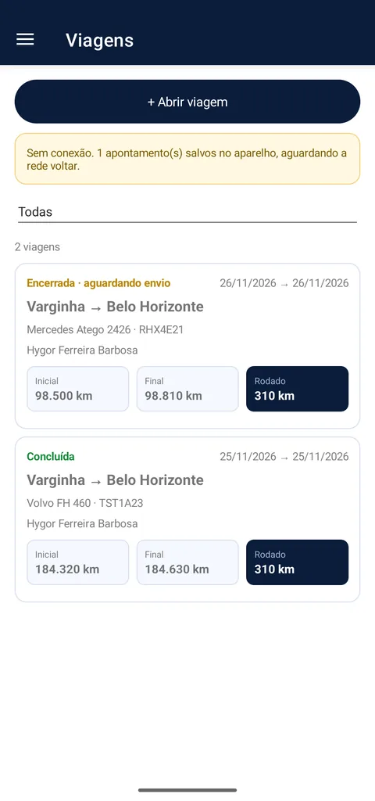{width=32%}

# Relatórios

Menu > **Relatórios**.

## Escolher o período

No alto da tela: **3 m**, **6 m**, **1 ano**, **2 anos** ou **Tudo**. Para outro período, toque em
**Personalizar**:

- **Por mês ou ano:** escolha o mês e o ano, ou só o ano, e toque em **Aplicar**;
- **Período livre:** escolha a data de início e a de fim e toque em **Aplicar**.

Tudo na tela passa a valer para esse período.

## O que a tela mostra

- **Resultado do período:** entradas menos saídas. Ao lado ficam as entradas, as saídas, o que há
  a receber e a pagar neste mês, os pendentes em atraso e a maior despesa.
- **Entradas e saídas por mês:** gráfico de colunas. **Toque em um mês** para ver os valores exatos.
- **Despesas por categoria:** gráfico de rosca. Toque numa fatia para ver o valor.
- **Frota no período:** veículos em viagem agora, rentabilidade das viagens, as **rotas mais
  lucrativas** e os **veículos mais eficientes** (menor custo por km rodado e consumo em km/l).

Os números da frota dependem de as despesas e receitas estarem **vinculadas às viagens** (veja
[Movimentações](#lançar-uma-entrada-ou-saída)).

## Exportar

Em **Exportar o período filtrado**, toque em **PDF** para um relatório pronto para imprimir ou
mandar, ou em **CSV (planilha)** para abrir no Excel. O celular abre as opções de compartilhamento:
salvar no Drive, enviar pelo WhatsApp ou por e-mail.

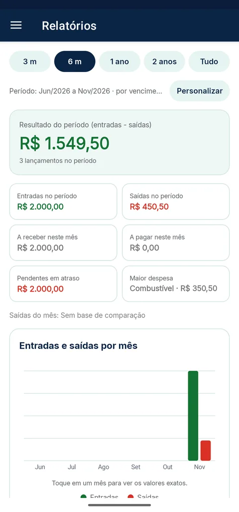{width=32%}
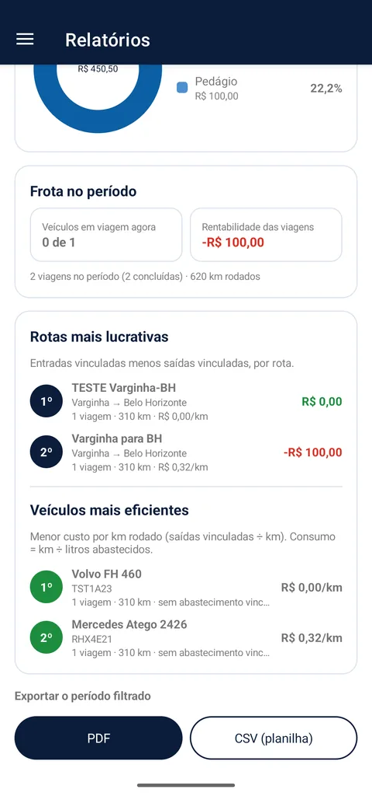{width=32%}
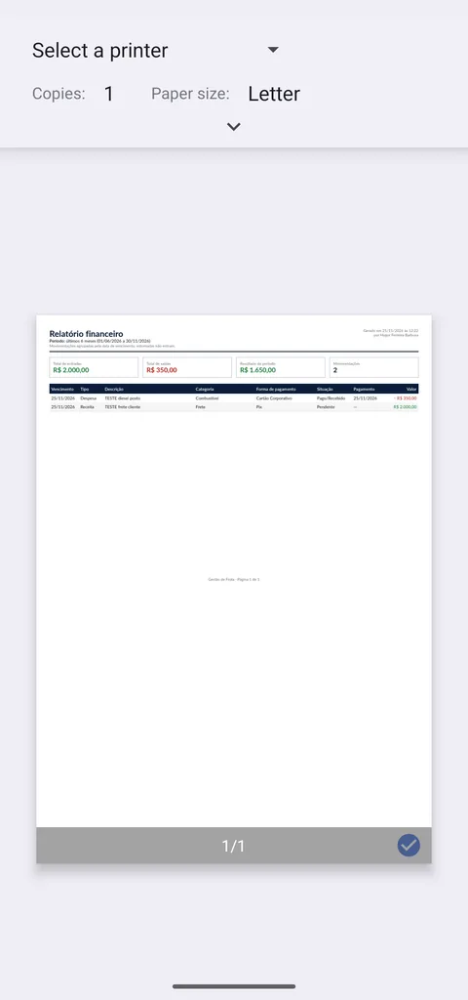{width=32%}

# Usuários (só o Administrador)

Menu > **Usuários** mostra todos que já entraram no aplicativo.

1. Encontre a pessoa na lista.
2. Em **Perfil do usuário**, escolha Administrador, Gestor de Frota, Financeiro ou Motorista.
3. Toque em **Salvar perfil**.

A pessoa vê o menu novo depois de tocar em **Sair** e entrar de novo com o Google: o perfil viaja
dentro da sessão, que só é renovada num login novo.

# Problemas comuns

| O que acontece | O que fazer |
|---|---|
| Entrei, mas o menu só tem Início, Viagens e Frota | A sua conta ainda é de Motorista. Peça ao administrador para mudar o seu perfil. |
| O login abre o Google, mas não volta para o aplicativo | Feche o aplicativo e tente de novo. Se continuar, avise o responsável pelo sistema. |
| "Sem conexão" ao salvar um lançamento | Lançamentos precisam de internet. Espere o sinal voltar e salve de novo. |
| Viagem continua "aguardando envio" | Com internet, abra **Viagens** e puxe a tela para baixo. |
| Não aceita o hodômetro final | O número precisa ser maior que o inicial. Confira o painel do caminhão. |
| O veículo não aparece para abrir viagem | Ele está em viagem, em manutenção ou desativado. Veja a situação em **Frota**. |
| Não aceita a placa | Use ABC-1234 (antiga) ou ABC1D23 (Mercosul) e confira se ela já não está cadastrada. |
| A foto do comprovante não sobe | A foto tem mais de 5 MB. Tire outra ou escolha uma imagem menor na galeria. |
| A câmera não abre | Libere a câmera nas configurações do celular (o app oferece o atalho) ou use a **Galeria**. |
| Não vejo os botões de pagar, estornar ou desativar | Eles só aparecem para o perfil que pode usá-los. Veja [O que cada perfil vê](#o-que-cada-perfil-vê). |

# Palavras usadas no aplicativo

| Palavra | Significado |
|---|---|
| Receita | Dinheiro que entra (ex.: frete recebido). |
| Despesa | Dinheiro que sai (ex.: combustível, pedágio). |
| Pendente | Ainda não foi pago ou recebido. |
| Estornar | Cancelar um lançamento sem apagar o histórico. |
| Hodômetro | O contador de quilômetros do painel do caminhão. |
| Rentabilidade | Receitas da viagem menos despesas da viagem. |
| Custo por km | Despesas da viagem divididas pelos quilômetros rodados. |
| Consumo (km/l) | Quilômetros rodados divididos pelos litros abastecidos. |
